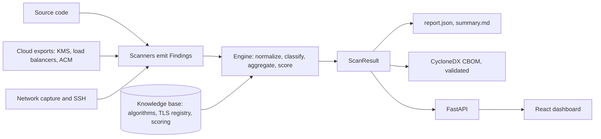

# QuantumTrace

Cryptographic inventory and post-quantum readiness scanner. It reads source code, cloud configuration exports
and network captures, classifies every cryptographic asset (CRITICAL, MEDIUM, SAFE or UNKNOWN against quantum
attacks), scores the result from 0 (best) to 100 (worst) with a grade from A to F, and writes a validated
CycloneDX CBOM, a JSON report and a Markdown summary. A React dashboard shows the result.

## Quick start (Docker)

One command builds the image and serves the dashboard (needs only Docker):

```bash
scripts/demo.sh --docker
```

Or step by step:

```bash
docker build -t quantumtrace .
docker run --rm -p 8000:8000 quantumtrace
```

Open http://localhost:8000. The dashboard starts empty. Use the Scan button to scan a folder, upload a repository
.zip, paste a public GitHub link, try the starter kit that ships in the image (`sample-repos`, `cloud-posture`,
`network-capture`), or scan the whole starter kit in one click. Clear empties the dashboard again. To scan your own
directory, mount it:

```bash
# Scan a directory from the command line and keep the reports in ./out
docker run --rm -v "$PWD":/data -v "$PWD/out":/app/out quantumtrace \
  qtrace scan /data --out /app/out --format json,cbom,md

# Show that scan in the dashboard (it reads out/report.json)
docker run --rm -p 8000:8000 -v "$PWD/out":/app/out quantumtrace
```

Inside the container, the Scan paths field accepts only `/data` and the three starter kit directories. The
limit is the `QTRACE_SCAN_ROOTS` environment variable (separated by `:`). When it is unset, as in local
development, any server-side path is accepted, so do not expose that setup to other users.

## Local development

```bash
make install                      # uv sync into .venv (Python 3.12)
make check                        # ruff and pytest
.venv/bin/qtrace scan sample-repos cloud-posture network-capture --out out/ --format json,cbom,md
make api                          # FastAPI on :8000
npm --prefix frontend ci
make ui                           # Vite on :5173, proxies /api to :8000
```

`tshark` improves network capture parsing. Without it the scanner falls back to a pure Python parser.

`scripts/demo.sh` is the deterministic demo run on the starter kit. It scans the three folders, validates the CBOM
and writes `out/report.json`, `out/cbom.json` and `out/summary.md`:

```bash
scripts/demo.sh            # scan, validate the CBOM, print the summary (local .venv)
scripts/demo.sh --serve    # then start the API and dashboard on http://127.0.0.1:8000
scripts/demo.sh --docker   # build the image and serve the dashboard from Docker
```

`qtrace scan --probe host:port` (repeatable) also checks a live TLS endpoint for hybrid post-quantum key exchange.

## Known limits

- The code scanner covers Python, Java and Go. JavaScript and TypeScript, compiled binaries and lock files are not scanned.
- Algorithms chosen in another method or file are reported as unresolved, not guessed.
- The starter kit is synthetic. Accuracy is measured against its labelled answer key; outside it only coverage is measured.
- Repository scans have size and file caps but no timeout, and private GitHub repositories are not supported.
- The Docker image runs as root, installs from `pyproject.toml` (not `uv.lock`) and writes report files with mode 0600.

## How it fits together



`ScanResult` is the single contract between the scanners, the engine, the outputs and the dashboard.

| Path | Content |
|---|---|
| `src/quantumtrace/scanners/` | Code, cloud and network scanners (each emits Findings) |
| `src/quantumtrace/engine/` | Normalization, classification, aggregation, scoring, roadmap |
| `src/quantumtrace/kb/` | Algorithm, TLS and cloud registries and the scoring policy |
| `src/quantumtrace/output/` | CycloneDX CBOM, JSON report and Markdown summary writers |
| `api/main.py` | HTTP layer over one stored ScanResult |
| `frontend/` | Vite, React and Tailwind dashboard |
| `docs/PLAN.md` | Design and plan |

## API

| Endpoint | Purpose |
|---|---|
| `GET /api/source` | `scan` when a result is stored, `none` while the dashboard is empty |
| `GET /api/result` | The stored ScanResult (`out/report.json`); 404 until something is scanned |
| `POST /api/scan` | Body `{"paths": [...]}`, scans server-side paths and stores `out/report.json` |
| `POST /api/scan/upload`, `POST /api/scan/github` | Scan a zipped repository or a public GitHub link |
| `POST /api/scan/starter-kit` | Scan `sample-repos`, `cloud-posture` and `network-capture` and store the result |
| `DELETE /api/scan` | Forget the stored result; the dashboard is empty again |
| `GET /api/cbom` | CycloneDX 1.6 CBOM built from the current result |
| `GET /api/validate` | Strict schema validation of that CBOM |
| `GET /api/report.md` | Markdown summary |
| `GET /api/scoring` | The scoring policy behind the score, read only |

---

# Starter kit (material de descoberta)

Material para o desafio de inventario criptografico / migracao PQC:
codigo-fonte para analise estatica, exports sinteticos de configuracao
cloud, e uma captura de rede sintetica.

```
sample-repos/      codigo-fonte Python/Java/Go para analise estatica
cloud-posture/     exports JSON sinteticos (KMS, load balancers, certificados)
network-capture/   captura de rede sintetica (network.pcap)
```

Ver o README de cada pasta para detalhes de como correr/inspecionar.
